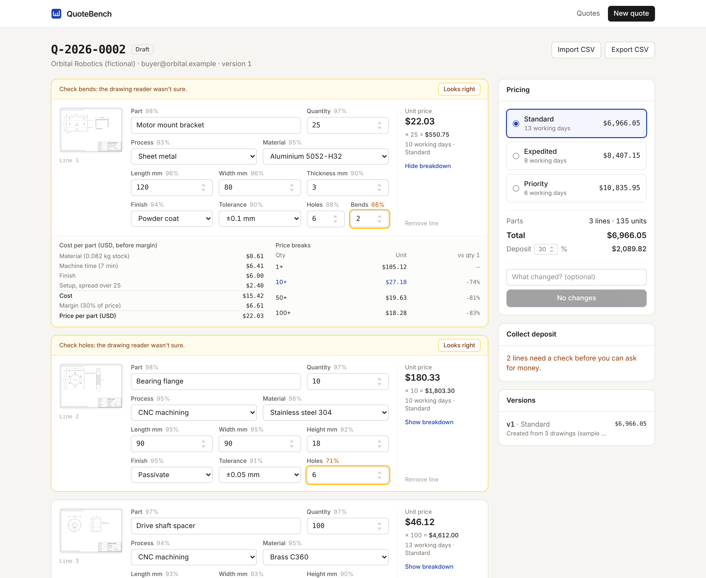
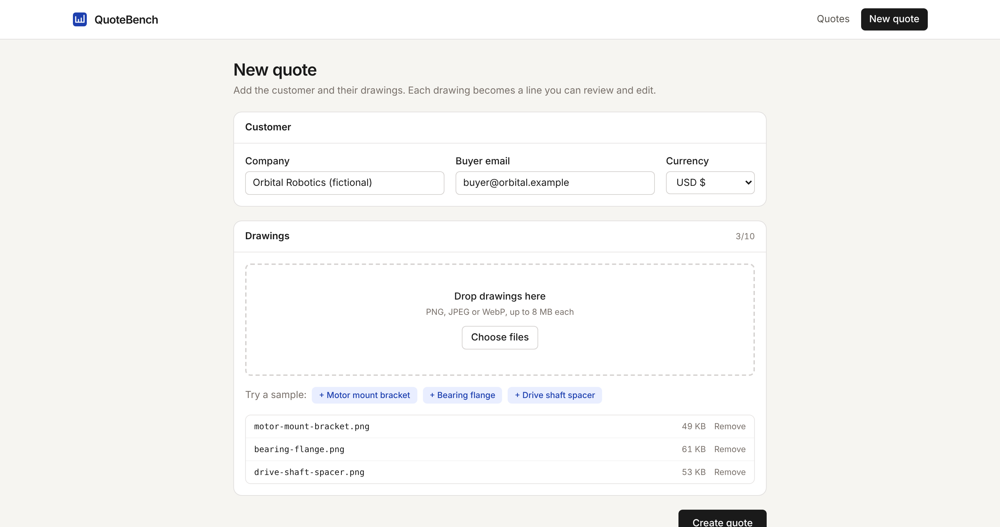
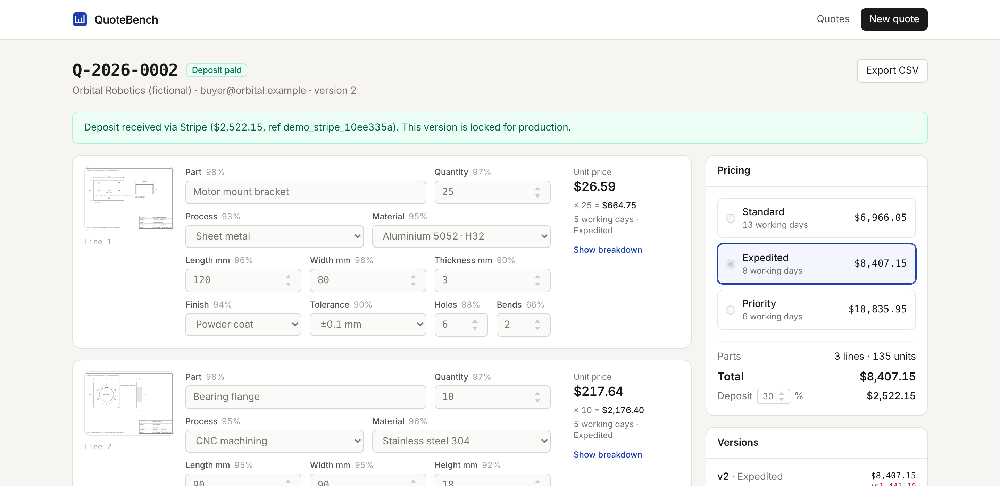
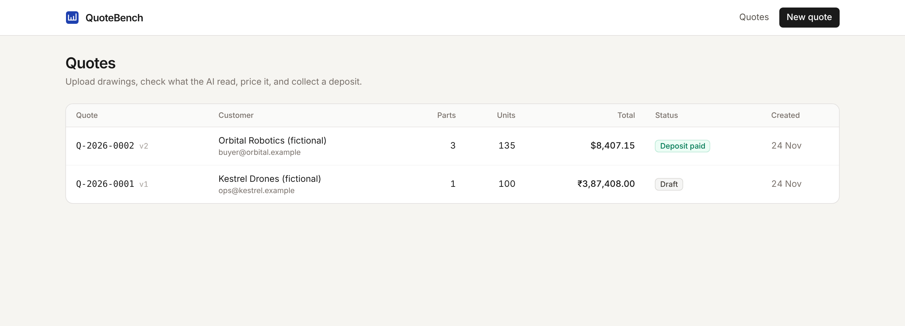
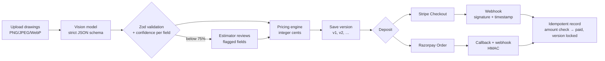

# ai-quote-builder

[](https://github.com/prakash6018/ai-quote-builder/actions/workflows/ci.yml)

A quoting tool for a machine shop. Upload a customer's engineering drawings and a vision model reads each one: part name, material, dimensions, quantity, finish, tolerance, holes, bends. An estimator checks the fields the model wasn't sure about, the pricing engine quotes every part, and the customer pays a deposit through **Stripe** or **Razorpay**.

**Next.js 15 · React 19 · TypeScript · Tailwind CSS v4 · TanStack Query · Zod · GPT-4o vision (any OpenAI-compatible endpoint) · Stripe · Razorpay**



| New quote | Deposit paid, version locked |
|---|---|
|  |  |



## The flow



## What's in it

**Drawing extraction** (`lib/extract.ts`)
- Sends the image to a vision model with a strict JSON Schema (structured outputs), then validates the reply again with Zod. Every field comes back with a confidence.
- Fields under 75% confidence are outlined and the line is flagged. You can't ask for a deposit until someone has checked them.
- Uploads are checked by magic bytes, not file extension, and stored by SHA-256.
- No API key? A sample extractor reads the three bundled drawings in `public/samples/` offline. Any other upload gets a low-confidence guess for the reviewer to fill in.

**Pricing engine** (`lib/pricing.ts`)
- Material: stock volume with allowance × density × price per kg, plus scrap.
- Machine time: depends on process (CNC or sheet metal), part size, holes and bends, material machinability and tolerance class.
- Finish uses area-based rates with a minimum charge.
- Setup cost is spread over the batch, and run-time discounts apply at 10, 50 and 100 units.
- Three margin tiers (Standard / Expedited / Priority) change both price and lead time. Margin is a share of price, the way finance reports it.
- All money is integer cents, converted to INR once with a rate fixed on the quote, so totals always add up exactly.
- The UI shows the full cost breakdown and price breaks for every part. The server recomputes totals on save and never trusts the client's numbers.

**Quote workflow**
- Every save creates a new version (v1, v2, …) with a note and the change in total. A stale tab can't overwrite a newer version (409).
- CSV import has row-numbered errors ("Row 3: material "unobtanium" isn't recognised"). CSV export includes prices and blocks spreadsheet formula injection.
- Once a deposit is paid, that version is locked for production. Changing a quote that's awaiting payment cancels the open checkout, because the old link was for a different total.

**Payments, with no SDKs** (`lib/payments/`)
- **Stripe**: creates a Checkout Session with an idempotency key. The webhook is verified against the raw body using `t=…,v1=…` HMAC-SHA256 with a 5-minute replay window and constant-time comparison.
- **Razorpay**: creates an Order. The Checkout callback is verified with `HMAC(order_id|payment_id)` and webhooks with `X-Razorpay-Signature`.
- Payment events are **idempotent** (providers retry, and Razorpay sends both `payment.captured` and `order.paid`) and **amount-checked**: a payment that doesn't match the requested deposit is recorded but doesn't mark the quote paid.
- **Demo mode**: without keys, a simulated checkout builds the exact event the provider would send, signs it, and runs it through the same verification and handler code.

## Run it

```bash
npm install
cp .env.example .env.local     # optional: OPENAI_API_KEY, Stripe and Razorpay test keys
npm run dev                    # http://localhost:3001
npm test                       # pricing, CSV, extraction, payments, store (14 tests)
```

Click **New quote** and **+ Motor mount bracket / Bearing flange / Drive shaft spacer** to try it with no keys at all.

With real keys:
- **Vision:** `OPENAI_API_KEY` (and optionally `OPENAI_BASE_URL` for Azure OpenAI, `VISION_MODEL`).
- **Stripe:** `STRIPE_SECRET_KEY` and `STRIPE_WEBHOOK_SECRET`, then `stripe listen --forward-to localhost:3001/api/webhooks/stripe`.
- **Razorpay:** `RAZORPAY_KEY_ID`, `RAZORPAY_KEY_SECRET` and `RAZORPAY_WEBHOOK_SECRET`. The webhook points at `/api/webhooks/razorpay`.

## Project layout

```
lib/catalog.ts         materials, processes, finishes, tolerances, tiers, quantity breaks
lib/pricing.ts         estimating model (integer cents)
lib/extract.ts         vision extraction, sample extractor, image sniffing
lib/csv.ts             RFC 4180 parser, import with row errors, safe export
lib/payments/          Stripe and Razorpay: create checkout/order, verify signatures
lib/deposits.ts        provider events → idempotent, amount-checked payment records
lib/store.ts           JSON-file store with atomic writes, versions, payments
app/api/               quotes, deposit, files, webhooks, Razorpay verify, demo checkout
components/            QuoteEditor, LineCard, NewQuote, QuoteList, DemoCheckout
```

## Limits

- Storage is a JSON file, to keep the demo dependency-free. The store's functions map one-to-one onto Postgres tables (quotes, quote_versions, payments).
- No sign-in: this is an internal estimator tool. Put it behind your SSO, or reuse the signed-session and RBAC approach from [gateway-dashboard](https://github.com/prakash6018/gateway-dashboard).
- Rates and materials are illustrative. A real shop would load its own rate card.
- PDF drawings would need a page-to-image step before extraction.

## License

MIT
